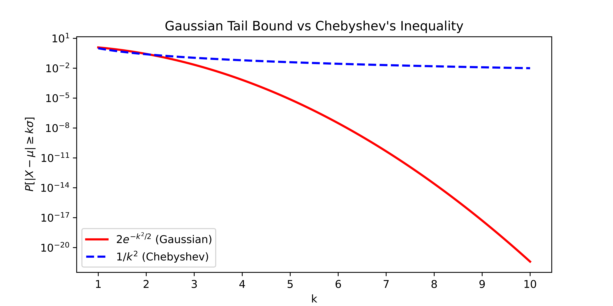
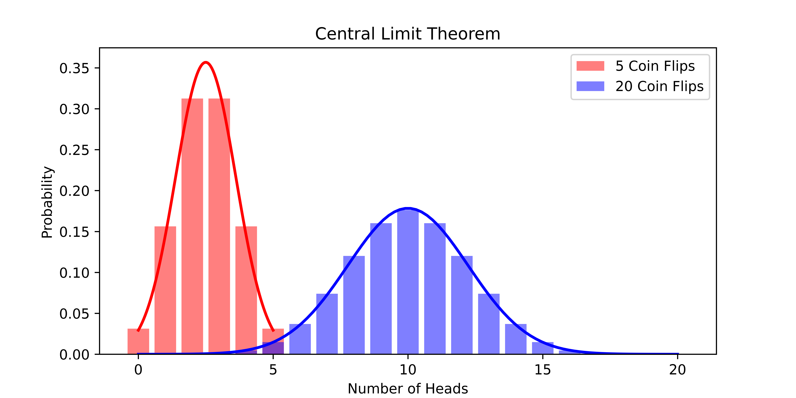

Let's recall Chebyshev's inequality.

**Chebyshev's Inequality:**
Let $X$ be a random variable with expectation $\mu=\mathbb{E}[X]$ and variance $\sigma^2 = \textrm{Var}[X]$. Then for any $k > 0$,

$$
\Pr(|X - \mu| > k \sigma) \leq \frac{1}{k^2}.
$$

Last time, we applied Chebyshev's inequality to the load balancing problem.
In particular, we showed if we assign $n$ requests to $n$ servers, the server with the maximum load has $O(\sqrt{n})$ requests with high probability.
We proved this result by applying Chebyshev's to a particular server and then applying the union bound to get a bound on the maximum load across all servers.
Recall that we proved both Chebyshev's inequality and the union bound with Markov's inequality.
So, if you squint, we just used Markov's inequality twice.

Today, we'll prove a stronger result that the server with the maximum load has $O(\log n)$ requests with high probability.
For this result, we'll need a stronger concentration inequality than Chebyshev's.

## Improving Chebyshev's Inequality

We'll see that Chebyshev's inequality is accurate for *some* random variables.
But, for many other random variables, the inequality is loose.

One random variable for which Chebyshev's inequality is loose is the normal distribution.

**Gaussian Tail Bound:**
Consider a random variable $X$ drawn from the normal distribution $\mathcal{N}(\mu, \sigma^2)$ with mean $\mu$ and standard deviation $\sigma$.
Then for any $k > 0$,
$$
\Pr \left( | X - \mu | \geq k \sigma \right)
\leq 2 e^{-k^2/2}.
$$

Comparing the Gaussian tail bound to Chebyshev's inequality, we see that the Gaussian Tail Bound is *exponentially* better.
Let's see the difference graphically in the figure below.
(Notice that the vertical axis is on a logarithmic scale.)
By $10$ standard deviations above the mean, the Gaussian tail bound gives a bound that is 18 orders of magnitude smaller than the bound from Chebyshev's inequality!

Based on how loosely Chebyshev's inequality bounds the Gaussian distribution, we might suspect that Chebyshev's inequality is loose in general.
But, there are examples of random variables where Chebyshev's inequality gives exactly the right probabilities.

**Example Random Variable:**
Fix a particular value $k > 1$.
We'll construct a random variable $X$ with mean $0$ and variance $1$.
In particular, let

$$
X = \begin{cases}
-k & \textrm{with probability } \frac{1}{2k^2} \\
0 & \textrm{with probability } 1-\frac{1}{k^2} \\
k & \textrm{with probability } \frac{1}{2k^2}.
\end{cases}
$$

We should first check that $X$ is a proper random variable and all the probabilities sum to $1$.
Next, notice that $\mathbb{E}[X] = 0$ and so
$$
\textrm{Var}[X] = \mathbb{E}[X^2] = (-k)^2 \cdot \frac{1}{2k^2} + (k)^2 \cdot \frac{1}{2k^2} = 1.
$$

Then Chebyshev's inequality tells us that
$$
\Pr(|X| \geq k) \leq \frac{1}{k^2}.
$$
This is exactly true for our random variable $X$
so Chebyshev's inequality is tight for this random variable.
Notice that we constructed the random variable after fixing the value $k$.
Do you think there's one random variable that is tight for *all* values of $k$?

While Chebyshev's inequality is tight for some random variables, it is loose for many other random variables.
We may therefore suspect that if we make stronger assumptions on the random variables, we can get better concentration inequalities.
The central limit theorem gives us a hint about what type of random variables we should consider.

**Central Limit Theorem:**
Any sum of *mutually independent* and identically distributed random variables $X_1, \ldots, X_n$ with mean $\mu$ and finite variance $\sigma^2$ converges to a Gaussian random variable with mean $n \cdot \mu$ and variance $n \cdot \sigma^2$ as $n$ goes to infinity.
That is, for large $n$,
$$
\sum_{i=1}^n X_i \approx \mathcal{N}(n\mu, n\sigma^2).
$$

By linearity of expectation and linearity of variance, we know what the mean and variance of the sum should be. The interesting part of the central limit theorem is that the sum converges to a Gaussian distribution.

We stated the central limit theorem for random variables that are identically distributed so that we could cleanly describe the expectation and variance of the sum. But the central limit theorem also holds for random variables that are not identically distributed.

For the central limit theorem to hold, we assumed that the random variables are *mutually independent*.
Recall that $X_1, \ldots, X_n$ are mutually independent if, for all values $v_1, \ldots, v_n$, we have
$$
\Pr( X_1=v_1, \ldots, X_n = v_n)
$$
$$
= \Pr(X_1=v_1) \cdot \ldots \cdot \Pr(X_n = v_n).
$$

Let's consider the central limit theorem in the context of the coin flip example.
The figure below shows how closely the sum of $n$ coin flips is approximated by the corresponding Gaussian distribution.
As $n$ increases, the approximation gets better and better.

Using Chebyshev's inequality, we showed that if we flip a fair coin 100 times, the probability we see fewer than 30 or more than 70 heads is at most $6.25\%$.
Let's *assume* that the central limit theorem holds exactly for 100 coin flips.
Then the sum of the random variables $X_1, \ldots, X_{100}$ would be distributed as $\mathcal{N}(50, 25)$.
(Recall we computed that the mean is 50 and the variance is 25 using a sum of indicator random variables for the event that each flip landed heads.)
By the Gaussian tail bound, 
$$
\Pr(|X - \mu| \geq k \cdot \sigma) = 
\Pr(|X - 50| \geq 4 \cdot 5 )
$$
$$
\leq 2 e^{-4^2/2} = 2 e^{-8} \approx .06\%
$$
Notice that we set $k=4$ to get the probability that the number of heads is more than 20 away from its mean.
The probability we get using the Gaussian tail bound is much smaller than the probability we got using Chebyshev's inequality!
But, we made a big assumption that the central limit theorem holds exactly for 100 coin flips.

Luckily, there are concentration inequalities that allow us to *formally* get exponentially small probability bounds.

### Exponential Concentration

There are many exponential concentration inequalities.
Each one makes a different set of assumptions on the random variable and,
depending on how stringent the assumptions, gives a different bound.
Sometimes the bounds are stated with multiplicative error and sometimes the bounds are stated with additive error.
The trick is determining which bound is appropriate for the application at hand.
We'll state three exponential concentration inequalities today but there are many more.
If you're having trouble finding an appropriate bound for your case, *Wikipedia is your friend.*

**Chernoff Bound:**
Let $X_1, \ldots, X_n$ be independent binary random variables.
That is, $X_i \in \{0,1\}$.
Let $p_i = \mathbb{E}[X_i]$ where $0 < p_i < 1$.
Choose a parameter $\epsilon > 0$.
Then the sum $S = \sum_{i=1}^n X_i$,
which has mean $\mu = \sum_{i=1}^n p_i$,
satisfies
$$
\Pr( S \geq (1+\epsilon) \mu )
\leq \exp\left(\frac{-\epsilon^2 \mu}{2+\epsilon}\right)
$$
and, if $0 < \epsilon < 1$,
$$
\Pr( S \leq (1-\epsilon) \mu)
\leq \exp\left(\frac{-\epsilon^2 \mu}{2}\right).
$$

Notice that the first inequality gives an upper bound on the probability that $S$ exceeds its expectation by a factor of $1+\epsilon$ while the second inequality gives an upper bound on the probability that $S$ falls below its expectation by a factor of $1-\epsilon$.

Using the union bound, we can combine them into a single inequality when $0 < \epsilon < 1$,

$$
\Pr(|S - \mu| \geq \epsilon \mu) \leq 2 \exp\left(\frac{-\epsilon^2 \mu}{3}\right).
$$

<!--- Inequality in wrong direction.

Looking back, we may realize that the last expression looks similar to the Gaussian tail bound.
This is because $\sigma \leq \sqrt{\mu}$.
To see this, observe that
$$
\sigma^2 = \textrm{Var}[S] = \sum_{i=1}^n \textrm{Var}[X_i] = \sum_{i=1}^n \mathbb{E}[X_i^2] - \mathbb{E}[X_i]^2
$$
$$
\leq \sum_{i=1}^n \mathbb{E}[X_i^2] = \sum_{i=1}^n \mathbb{E}[X_i] = \mu.
$$
Here, we used the property that squaring a binary variable does not change its value.
Setting $k = \epsilon \sqrt{\mu}$
so that $\epsilon \mu \geq k \sigma$, the Chernoff bound becomes
$$
\Pr(|S - \mu| \geq k \sigma) \geq
\Pr(|S - \mu| \geq \epsilon \mu)
$$
$$
\leq 2 \exp\left(\frac{-\epsilon^2 \mu}{3}\right) = 2 \exp\left(\frac{-k^2}{3}\right).
$$
Notice this is basically the same as the Gaussian tail bound but with a *slightly* worse constant in the exponent.
--->

The Chernoff bound may seem overly restrictive because we require that each variable is binary.
The Bernstein inequality relaxes the assumption so that we can consider random variables defined on the interval from $-1$ to $1$.

**Bernstein Inequality:**
Let $X_1, \ldots, X_n$ be independent random variables with each $X_i \in [-1, 1]$.
Let $\mu = \sum_{i=1}^n \mathbb{E}[X_i]$
and $\sigma^2 = \sum_{i=1}^n \textrm{Var}[X_i]$.
Then, for any $k \leq \frac{\sigma}{2}$,
the sum $S = \sum_{i=1}^n X_i$ satisfies
$$
\Pr(|S - \mu| > k \sigma) \leq 2 \exp\left(\frac{-k^2}{4}\right).
$$
Notice that the bound is similar to the Chernoff bound but the denominator in the exponent is larger.
As we weaken the assumptions on the random variables, we get weaker bounds.

Of course, while weaker than Chernoff bound, the assumption in the Bernstein bound is still not very general.
Hoeffding's inequality relaxes it further.

**Hoeffding's Inequality:**
Let $X_1, \ldots, X_n$ be independent random variables with each $X_i \in [a_i, b_i]$.
Let $\mu= \sum_{i=1}^n \mathbb{E}[X_i]$.
Then, for any $k >0$,
the sum $S = \sum_{i=1}^n X_i$ satisfies
$$
\Pr( | S - \mu | > k )
\leq 2 \exp\left(\frac{-2k^2}{\sum_{i=1}^n (b_i - a_i)^2}\right).
$$

Notice that $\sigma$ no longer appears in the bound.
In some sense, the sum of the intervals in the denominator of the exponent is a measure of the variance of the random variables.

We won't see the proofs of these concentration inequalities.
The general techniques are to apply Markov's inequality to cleverly chosen random variables.
Recall that we proved Chebyshev's inequality by applying Markov's inequality to the random variable $(X-\mathbb{E}[X])^2$.
Similarly, many exponential concentration inequalities are proved by defining $q$th central moments 
$$\mathbb{E}[(X-\mathbb{E}[X])^q]$$
or functions like $\exp(X - \mathbb{E}[X])$
and applying Markov's inequality.

### Coin Flips

Now that we have rigorous exponential concentration inequalities, let's apply them to the coin flip problem.

**Biased Coin Bound:**
Let the probability that a coin lands heads be $b$.
Choose $n \geq \frac{3\log(2/\delta)}{\epsilon^2}$.
If we flip a biased coin $n$ times, let $S$ be the number of heads.
Notice that $\mu = bn$.
Then
$$
\Pr(| S - b n | \geq \epsilon n) \leq \delta.
$$

**Proof:**
We use the Chernoff bound because the number of heads is a sum of binary random variables.
From the Chernoff bound, we know that for any $\epsilon'$,
$$
\Pr( | S - bn | \geq \epsilon' bn ) \leq 2 \exp\left(\frac{-\epsilon'^2 bn}{3}\right).
$$
Let's set $\epsilon' = \frac{\epsilon}{b}$.
Then
$$
\Pr( | S - bn | \geq \epsilon n ) \leq 2 \exp\left(\frac{-\epsilon^2 n}{3b}\right)
\leq 2 \exp\left(\frac{-\epsilon^2 n}{3}\right).
$$
For the last inequality, we used the fact that $b \leq 1$.
If we want the probability to be at most $\delta$, then we can set $\delta$ greater than the probability and solve for $k$.
Doing this, we see that
$$
2 \exp\left(\frac{-\epsilon^2 n}{3}\right) \leq \delta
\Leftrightarrow
\frac{-\epsilon^2 n}{3} \leq \log \frac{\delta}{2}
\Leftrightarrow
n \geq \frac{3 \log(2/\delta)}{\epsilon^2}.
$$

Notice that we have a very gentle dependence on $\delta$.
If we increase $\delta$ from $1/10$ to $1/100$ or from $1/100$ to $1/10000$, then $\log(2/\delta)$ only increases by a factor of $2$.

### Load Balancing Problem

Let's apply our new tool to the load balancing problem.
Recall we randomly assigned $n$ jobs to $n$ servers using hash functions.

We defined $S_i$ to be the number of jobs assigned to server $i$.
Our goal was to find the smallest $B$ for which we could prove
$$
\Pr(\max_{i \in [n]} S_i \geq B)
\leq\frac{1}{10}.
$$

Using Chebyshev's, we got $B = \sqrt{n}$.
Let's see if we can do better.
Remember that it suffices to prove that, for any $i$,
$\Pr(S_i \geq B) \leq \frac{1}{10n}$.
To see this, observe the definition of the maximum and apply the union bound,
$$
\Pr(\max_i S_i \geq B)
= \Pr( S_1 \geq B \cup \ldots \cup S_n \geq B)
$$
$$
\leq \Pr(S_1 \geq B) + \ldots + \Pr(S_n \geq B)
\leq n \frac{1}{10n} = \frac{1}{10}.
$$

Consider a single server $i$.
Let $X_j$ be the indicator random variable that job $j$ is assigned to server $i$.
Then the number of jobs assigned to server $i$ is $S_i = \sum_{j=1}^n X_j$.
Since the probability job $j$ goes to server $i$ is $\frac{1}{n}$,
we have $\mathbb{E}[X_j] = \frac{1}{n}$ and so $\mathbb{E}[S_i] = \sum_{j=1}^n \frac{1}{n} = 1$.
Recall the first Chernoff bound tells us that
$$
\Pr(S_i \geq 1+\epsilon)
\leq \exp\left(\frac{-\epsilon^2}{2+\epsilon}\right)
$$
where we plugged in $\mu=1$.
We know the probability has to be at most $\frac{1}{10n}$.
We upper bound the probability to avoid the addition in the denominator of the exponent then we set the upper bound to be at most $\frac{1}{10n}$.
Doing this, we get
$$
\exp\left(\frac{-\epsilon^2}{2+\epsilon}\right) 
\leq \exp\left(\frac{-\epsilon^2}{2\epsilon}\right) \leq \frac{1}{10n}
$$
as long as $\epsilon \geq 2$. Then
$$
\Leftrightarrow
-\frac{1}{2}\epsilon \leq \log \frac{1}{10n}
\Leftrightarrow
\epsilon \geq 2 \log(10n).
$$
Plugging in this choice of $\epsilon$,
we have
$$
\Pr(S_i \geq 1 + 2 \log(10n))
\leq \frac{1}{10n}.
$$

So the server with the maximum load has at most $O(\log n)$ jobs with high probability.
This is much better than the $O(\sqrt{n})$ bound we proved with Chebyshev's inequality.

In practice, there's another strategy for assigning jobs to servers that works surprisingly well.
The idea is called the *power of two choices*.
Instead of assigning a job to a random server, we choose two random servers and assign the job to the least loaded server.
With probability $1/10$, the maximum loaded server is $O(\log \log n)$.
This is amazing! We barely changed the algorithm and we got an *exponentially* better bound.
We may suspect that if we choose three random servers and assign the job to the least loaded server, then the maximum loaded server is $O(\log \log \log n)$.
But, this is not the case.
The bound stays asymptotically the same.
The analysis is notoriously tricky and we won't cover it in this class.
But, if you're interested, you can find it in Section 2 of the notes [here](https://www.eecs.harvard.edu/~michaelm/postscripts/handbook2001.pdf).

