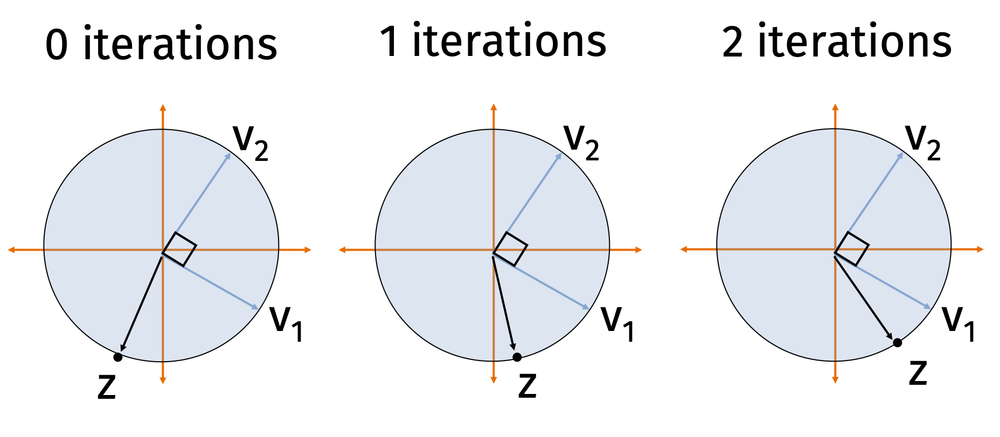
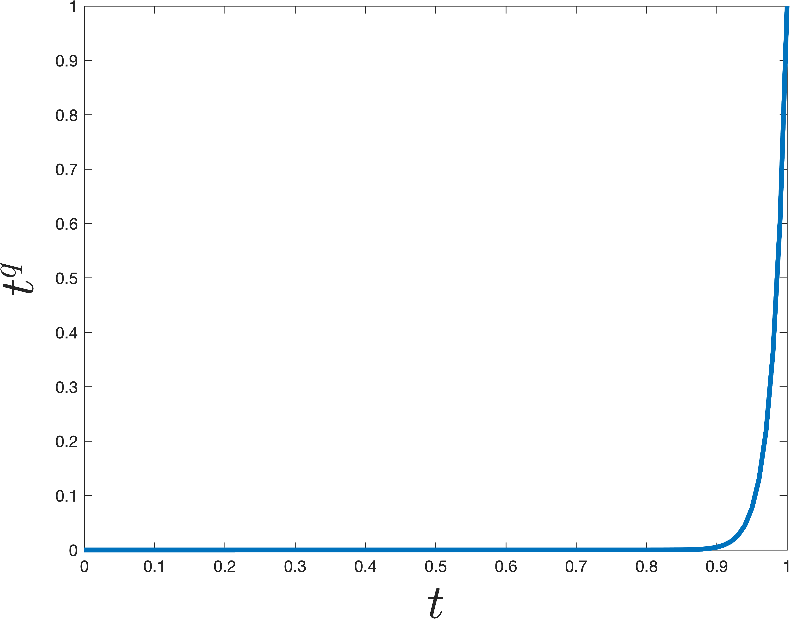
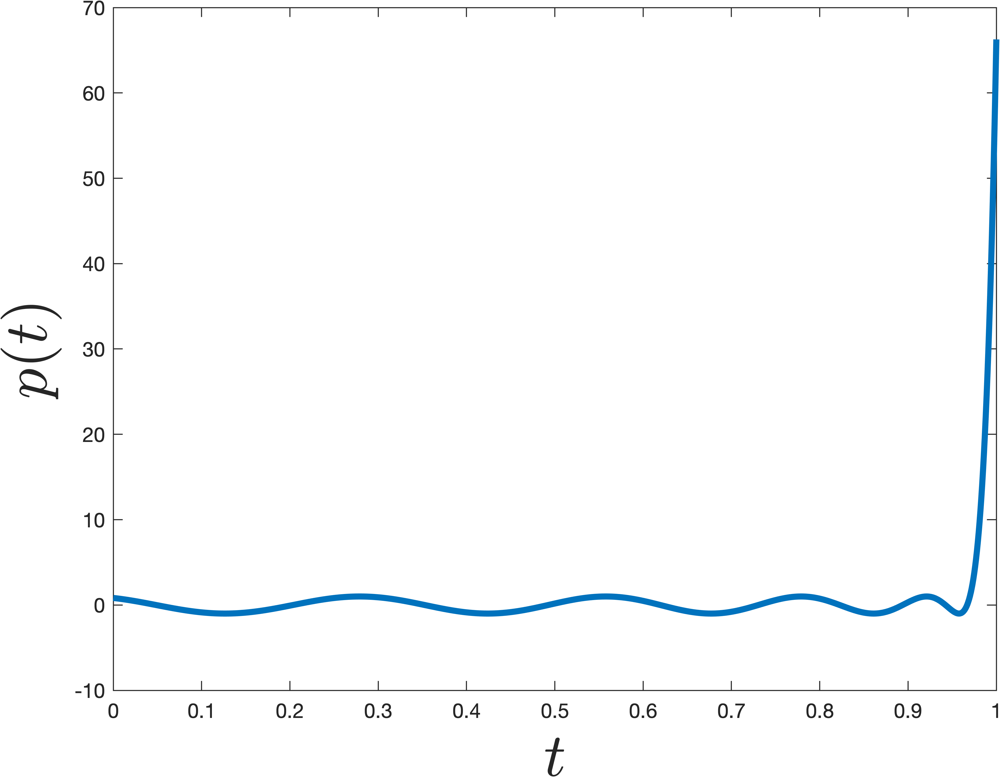

Previously, we used the SVD to find the best rank-$k$ approximation to a matrix $\mathbf{X}$.
For this application, notice that we didn't really need to find all the singular vectors and values.

We can save time by computing an approximate solution to the SVD.
In particular, we will only compute the top $k$ singular vectors and values.
We can do this with iterative algorithms that achieve time complexity $O(ndk)$ instead of $O(nd^2)$.
Today, we will see two such algorithms: the power method and the Lanczos method.

# The Power Method

The power method is a general algorithm for finding the dominant eigenvector of a square matrix. In the context of computing the SVD of a matrix $\mathbf{X} \in \mathbb{R}^{n\times d}$, we apply the power method to the square, symmetric matrix $\mathbf{A} = \mathbf{X}^\top \mathbf{X} \in \mathbb{R}^{d\times d}$. 

Because $\mathbf{A}$ is symmetric, it has real, non-negative eigenvalues $\lambda_1 \geq \lambda_2 \geq \ldots \geq \lambda_d \geq 0$ and orthonormal eigenvectors $\mathbf{v}_1, \mathbf{v}_2, \ldots, \mathbf{v}_d$. Notice that the eigenvectors of $\mathbf{A}$ are exactly the right singular vectors of $\mathbf{X}$, and its eigenvalues are the squared singular values ($\lambda_j = \sigma_j^2$).

**Power Method:**

* Choose $\mathbf{z}^{(0)}$ randomly. E.g. $\mathbf{z}^{(0)} \sim \mathcal{N}(\mathbf{0}, \mathbf{I}_d)$.
* $\mathbf{z}^{(0)} = \mathbf{z}^{(0)} /\|\mathbf{z}^{(0)}\|_2$
* For $i = 1,\ldots, m$
  * $\mathbf{z}^{(i)} = \mathbf{A} \mathbf{z}^{(i-1)}$
  * $n_i = \|\mathbf{z}^{(i)}\|_2$
  * $\mathbf{z}^{(i)}  = \mathbf{z}^{(i)}/n_i$
* Return $\mathbf{z}^{(m)}$

In other words, each of our iterates $\mathbf{z}^{(i)}$ is simply a scaling of a column in the following matrix:
$$
\mathbf{K} = \begin{bmatrix} \mathbf{z}^{(0)} & \mathbf{A}\mathbf{z}^{(0)} & \mathbf{A}^2 \mathbf{z}^{(0)} & \mathbf{A}^3\mathbf{z}^{(0)} \ldots \mathbf{A}^{m-1} \mathbf{z}^{(0)}\end{bmatrix}.
$$
Typically we run $m \ll d$ iterations, so $\mathbf{K}$ is a tall, narrow matrix. The span of $\mathbf{K}$'s columns is called a **Krylov subspace** because it is generated by starting with a single vector $\mathbf{z}^{(0)}$ and repeatedly multiplying by a fixed matrix $\mathbf{A}$. We will return to $\mathbf{K}$ shortly. 

## Analysis Preliminaries 

Let $\mathbf{v}_1, \ldots, \mathbf{v}_d$ be the orthonormal eigenvectors of $\mathbf{A}$. We can express our initial random vector in terms of this basis:
$$
\mathbf{z}^{(0)} = c_1^{(0)}\mathbf{v}_1 + c_2^{(0)}\mathbf{v}_2 + \ldots + c_d^{(0)} \mathbf{v}_d = \sum_{j=1}^d c_j^{(0)} \mathbf{v}_j
$$
where the coefficients are given by the inner product $c_j^{(0)} = \langle \mathbf{z}^{(0)}, \mathbf{v}_j \rangle = \mathbf{v}_j^\top \mathbf{z}^{(0)}$.

To see what happens when we repeatedly multiply by $\mathbf{A}$, we can rely on our outer product view of matrix multiplication. Recall the eigendecomposition of $\mathbf{A}$:
$$
\mathbf{A} = \sum_{j=1}^d \lambda_j \mathbf{v}_j \mathbf{v}_j^\top
$$

When we compute the next unnormalized iterate, $\mathbf{A} \mathbf{z}^{(i-1)}$, the outer product view makes the operation completely transparent:
$$
\begin{align*}
\mathbf{A} \mathbf{z}^{(i-1)} 
&= \left( \sum_{j=1}^d \lambda_j \mathbf{v}_j \mathbf{v}_j^\top \right) \mathbf{z}^{(i-1)} \\
&= \sum_{j=1}^d \lambda_j \mathbf{v}_j (\mathbf{v}_j^\top \mathbf{z}^{(i-1)}) \\
&= \sum_{j=1}^d \lambda_j c_j^{(i-1)} \mathbf{v}_j
\end{align*}
$$

Because $\mathbf{z}^{(i)} = \frac{1}{n_i} \mathbf{A} \mathbf{z}^{(i-1)}$, we can see exactly how the coefficients update:
$$
c_j^{(i)} = \frac{1}{n_i}\lambda_j c^{(i-1)}_j.
$$

The $\frac{1}{n_i}$ term is fixed for all $j$, but the $\lambda_j$ term will be largest for $j=1$, and thus $c_1^{(i)}$ will increase in size more than any other term. We will analyze this formally soon.

First, however, let's see what it suffices to prove.

**Claim 1**: If $\left|c_j^{(m)}/c_1^{(m)}\right| \leq \sqrt{\epsilon/d}$ for all $j\neq 1$ then either $\|\mathbf{v}_1 -\mathbf{z}^{(m)}\|_2^2\leq 2\epsilon$ or $\|-\mathbf{v}_1 - \mathbf{z}^{(m)}\|_2^2\leq 2\epsilon$. 

::: {.proof-block}

Proof of Claim 1

Since $c_1^{(m)} \leq 1$, the hypothesis implies that $\left|c_j^{(m)}\right| \leq \sqrt{\epsilon/d}$. Since our iterates are unit vectors, $\sum_{k=1}^d \left(c_k^{(m)}\right)^2 = 1$. It follows that $\left(c_1^{(m)}\right)^2 \geq (1-\epsilon)$ and thus $\left|c_1^{(m)}\right| \geq 1-\epsilon$. 

For any unit vector $\mathbf{x}$, we have $\|\mathbf{x} -\mathbf{z}^{(m)}\|_2^2 = 2 - 2\langle\mathbf{x},\mathbf{z}^{(m)}\rangle$. Since $\langle\mathbf{v}_1,\mathbf{z}^{(m)}\rangle = c_1^{(m)}$, we conclude that either $\langle\mathbf{v}_1,\mathbf{z}^{(m)}\rangle \geq 1-\epsilon$ or $\langle- \mathbf{v}_1,\mathbf{z}^{(m)}\rangle \geq 1-\epsilon$. 

Suppose without loss of generality it's the first: $\langle\mathbf{v}_1,\mathbf{z}^{(m)}\rangle \geq 1-\epsilon$. Then we would conclude that:
$$
\|\mathbf{v}_1 -\mathbf{z}^{(m)}\|_2^2 = 2 - 2\langle\mathbf{v}_1,\mathbf{z}^{(m)}\rangle \leq 2 - 2(1-\epsilon) = 2\epsilon.
$$

:::

So, to show the power method converges, our goal is to prove that $\left|c_j^{(m)}/c_1^{(m)}\right| \leq \sqrt{\epsilon/d}$ for all $j\neq 1$. 

## Heart of the Analysis 

To prove this bound, we note that $c_j^{(m)} = S\cdot \lambda_j^{m} c_j^{(0)}$ for any $j$ and $c_1^{(m)} = S\cdot \lambda_1^{m} c_1^{(0)}$ where $S = 1/\prod_{i=1}^m n_i$ is some fixed scaling. So:
$$
\left|\frac{c_j^{(m)} }{c_1^{(m)} }\right| = \left(\frac{\lambda_j}{\lambda_1}\right)^{m} \left|\frac{c_j^{(0)} }{c_1^{(0)} }\right|.
$$

As claimed in class (and can be proven as an exercise—try using rotational invariance of the Gaussian), if $\mathbf{z}^{(0)}$ is a randomly initialized start vector, $\left|\frac{c_j^{(0)} }{c_1^{(0)} }\right| \leq d^{3}$ with high probability. That may seem like a lot, but $(\lambda_j/\lambda_1)^{m}$ is going to be a tiny number, so it will easily cancel that out. In particular, 
$$
\left(\frac{\lambda_j}{\lambda_1}\right)^{m} = \left(1-\frac{\lambda_1-\lambda_j}{\lambda_1}\right)^{m} \leq (1-\gamma)^{m},
$$
where $\gamma = \frac{\lambda_1-\lambda_2}{\lambda_1}$ is our spectral gap parameter. As long as we set 
$$
m = \frac{\log(d^3\sqrt{d/\epsilon})}{\gamma} = O\left(\frac{\log(d/\epsilon)}{\gamma}\right),
$$
then $(1-\gamma)^{m} \leq \frac{\sqrt{\epsilon/d}}{d^3}$, and thus 
$$
\left|\frac{c_j^{(m)} }{c_1^{(m)} }\right| = \left(\frac{\lambda_j}{\lambda_1}\right)^{m} \left|\frac{c_j^{(0)} }{c_1^{(0)} }\right| \leq \frac{\sqrt{\epsilon/d}}{d^3} \cdot d^3 \leq \sqrt{\epsilon/d},
$$
as desired.

## Alternative Guarantee

In machine learning applications, we care less about actually approximating $\mathbf{v}_1$, and more that $\mathbf{z}$ is a "good top singular vector" in that it offers a good rank-1 approximation to $\mathbf{X}$. Using the outer product, we want to prove that the projection matrix error
$$
\|\mathbf{X} - \mathbf{X}\mathbf{z}\mathbf{z}^\top\|_F^2 = \|\mathbf{X}\|_F^2 - \|\mathbf{X}\mathbf{z}\mathbf{z}^\top\|_F^2
$$ 
is small, or equivalently, that $\|\mathbf{X}\mathbf{z}\mathbf{z}^\top\|_F^2$ is large. 

Notice that $\|\mathbf{X}\mathbf{z}\mathbf{z}^\top\|_F^2 = \|\mathbf{X}\mathbf{z}\|_2^2 = \mathbf{z}^\top \mathbf{X}^\top \mathbf{X} \mathbf{z} = \mathbf{z}^\top \mathbf{A} \mathbf{z}$. The largest this could possibly be is $\mathbf{v}_1^\top \mathbf{A} \mathbf{v}_1 = \lambda_1 = \sigma_1^2$. From the same argument above, where we claimed that either $\langle\mathbf{v}_1,\mathbf{z}^{(m)}\rangle \geq 1-\epsilon$ or $\langle- \mathbf{v}_1,\mathbf{z}^{(m)}\rangle \geq 1-\epsilon$, it is not hard to check that:
$$
\|\mathbf{X}\mathbf{z}\mathbf{z}^\top\|_F^2 \geq (1-\epsilon) \sigma_1^2,
$$ 
so after $O\left(\frac{\log(d/\epsilon)}{\gamma}\right)$ iterations we get a near optimal low-rank approximation. 

# The Lanczos Method  

We will now see how to improve on the power method using what is known as the Lanczos method. Like the power method, Lanczos is considered a **Krylov subspace method** because it will return a solution **in the span of the Krylov subspace**:

$$
\mathbf{K} = \begin{bmatrix} \mathbf{z}^{(0)} & \mathbf{A}\mathbf{z}^{(0)} & \mathbf{A}^2 \mathbf{z}^{(0)} & \mathbf{A}^3\mathbf{z}^{(0)} \ldots \mathbf{A}^{m-1} \mathbf{z}^{(0)}\end{bmatrix}.
$$

The power method clearly does this—it returns a scaling of the last column of $\mathbf{K}$. The whole idea behind Lanczos is to avoid "throwing away" information from earlier columns like the power method, but instead to take advantage of the whole space. It turns out that doing so can be very helpful; we will get an iteration bound that depends on $1/\sqrt{\gamma}$ instead of $1/\gamma$. 

Specifically, to define the Lanczos method, we will let $\mathbf{Q}\in \mathbb{R}^{d\times m}$ be a matrix with orthonormal columns that spans our Krylov subspace. In practice, we do not compute the Krylov matrix $\mathbf{K}$ directly and then orthonormalize it, as this is numerically unstable. Instead, because our target matrix $\mathbf{A}$ is symmetric, we can build the columns of $\mathbf{Q}$ iteratively using a highly efficient "three-term recurrence."

**Lanczos Method**

* Let $\mathbf{z}^{(0)}$ be a random initial starting vector. 
* Compute an orthonormal basis $\mathbf{Q}$ for the degree $m$ Krylov subspace spanned by $\{\mathbf{z}^{(0)}, \mathbf{A}\mathbf{z}^{(0)}, \mathbf{A}^2\mathbf{z}^{(0)}, \dots, \mathbf{A}^{m-1}\mathbf{z}^{(0)}\}$. 
* Form the $m \times m$ matrix $\mathbf{T} = \mathbf{Q}^\top \mathbf{A}\mathbf{Q}$. (Because $\mathbf{A}$ is symmetric, $\mathbf{T}$ will be a tridiagonal matrix, making it very cheap to store and manipulate).
* Let $\mathbf{z}$ be the top eigenvector of $\mathbf{T}$. 
* Return $\mathbf{Q} \mathbf{z}$. 

Importantly, the step to build $\mathbf{Q}$ only requires $m$ matrix-vector multiplications with $\mathbf{A}$, each of which can be implemented in $O(nd)$ time (if $\mathbf{A} = \mathbf{X}^\top \mathbf{X}$, we multiply by $\mathbf{X}$ then $\mathbf{X}^\top$). The step to find $\mathbf{z}$ might look a bit circular at first glance. We want an approximation algorithm for computing the top eigenvector of $\mathbf{A}$, and the above method uses a top eigenvector algorithm as a subroutine. But note that $\mathbf{T} = \mathbf{Q}^\top \mathbf{A}\mathbf{Q}$ only has size $m \times m$, where $m \ll d$ is our iteration count. So even if it's too expensive to compute a direct eigendecomposition of $\mathbf{A}$, the eigendecomposition of the small tridiagonal matrix $\mathbf{T}$ can be computed in just $O(m^3)$ time.

## Analysis Preliminaries  

Our first claim is that Lanczos returns the *best* approximate eigenvector in the span of the Krylov subspace. Then we will argue that there always exists *some* vector in the span of the subspace that is significantly better than what the power method returns, so the Lanczos solution must be significantly better as well.  

**Claim 2**: Amongst all vectors in the span of the Krylov subspace (i.e., any vector $\mathbf{y}$ that can be written as $\mathbf{y} = \mathbf{Q}\mathbf{x}$ for some $\mathbf{x}\in \mathbb{R}^m$), $\mathbf{y}^* = \mathbf{Q}\mathbf{z}$ maximizes $\mathbf{y}^\top \mathbf{A} \mathbf{y}$ (which equivalently minimizes the low-rank approximation error $\|\mathbf{X} - \mathbf{X}\mathbf{y}\mathbf{y}^\top\|_F^2$). 

::: {.proof-block}

Proof of Claim 2

To minimize the approximation error $\|\mathbf{X} - \mathbf{X}\mathbf{y}\mathbf{y}^\top\|_F^2$, the expression $\mathbf{X}\mathbf{y}\mathbf{y}^\top$ must represent a valid orthogonal projection of the data onto the vector $\mathbf{y}$. The outer product $\mathbf{y}\mathbf{y}^\top$ is only a valid projection matrix if $\mathbf{y}$ is a unit vector (meaning its length, or norm, is exactly $1$). 

Because we define $\mathbf{y} = \mathbf{Q}\mathbf{x}$, the length of $\mathbf{y}$ depends on $\mathbf{x}$. Since the matrix $\mathbf{Q}$ is orthonormal, multiplying by $\mathbf{Q}$ preserves the length of any vector. Therefore, for $\mathbf{y}$ to be a unit vector, $\mathbf{x}$ must also be a unit vector ($\|\mathbf{x}\|_2 = 1$).

To see why minimizing the approximation error is equivalent to maximizing the quadratic form, we apply the Pythagorean theorem for matrices. Projecting $\mathbf{X}$ onto a unit vector $\mathbf{y}$ separates $\mathbf{X}$ into orthogonal components:
$$
\|\mathbf{X}\|_F^2 = \|\mathbf{X}\mathbf{y}\mathbf{y}^\top\|_F^2 + \|\mathbf{X} - \mathbf{X}\mathbf{y}\mathbf{y}^\top\|_F^2
$$
Therefore, minimizing the residual error $\|\mathbf{X} - \mathbf{X}\mathbf{y}\mathbf{y}^\top\|_F^2$ is exactly equivalent to maximizing the norm of the projection:
$$
\|\mathbf{X}\mathbf{y}\mathbf{y}^\top\|_F^2 = \|\mathbf{X}\mathbf{y}\|_2^2 = (\mathbf{X}\mathbf{y})^\top(\mathbf{X}\mathbf{y}) = \mathbf{y}^\top \mathbf{X}^\top \mathbf{X} \mathbf{y} = \mathbf{y}^\top \mathbf{A} \mathbf{y}
$$

Proving the claim above is now equivalent to finding the unit vector $\mathbf{y}$ that maximizes $\mathbf{y}^\top \mathbf{A} \mathbf{y}$. Substituting $\mathbf{y} = \mathbf{Q}\mathbf{x}$, we want to maximize:
$$
(\mathbf{Q}\mathbf{x})^\top \mathbf{A} (\mathbf{Q}\mathbf{x}) = \mathbf{x}^\top (\mathbf{Q}^\top \mathbf{A} \mathbf{Q}) \mathbf{x}
$$
By the definition of eigenvectors, the unit vector $\mathbf{x}$ that maximizes this quadratic form is exactly the top eigenvector of the $m \times m$ matrix $\mathbf{Q}^\top \mathbf{A} \mathbf{Q}$. 

Recall from our algorithm definition that we explicitly defined $\mathbf{z}$ to be the top eigenvector of $\mathbf{T} = \mathbf{Q}^\top \mathbf{A} \mathbf{Q}$. Therefore, the $\mathbf{x}$ that maximizes our objective is exactly $\mathbf{z}$. Thus, the optimal vector in the subspace is $\mathbf{y}^* = \mathbf{Q}\mathbf{z}$.

:::

**Claim 3**: If we run the Lanczos method for $O\left(\frac{\log(d/\epsilon)}{\sqrt{\gamma}}\right)$ iterations, there is *some* vector $\mathbf{w}$ of the form $\mathbf{w} = \mathbf{Q}\mathbf{x}$ such that either $\langle\mathbf{v}_1,\mathbf{w}\rangle \geq 1-\epsilon$ or $\langle- \mathbf{v}_1,\mathbf{w}\rangle \geq 1-\epsilon$. 

In other words, there is some $\mathbf{w}$ in the Krylov subspace that has a large inner product with the true top eigenvector $\mathbf{v}_1$. As seen earlier for the power method, this can be used to prove that e.g. $\mathbf{w}^\top \mathbf{A} \mathbf{w}$ is large, and from **Claim 2**, we know that the vector returned by Lanczos can only do better. So, we focus on proving **Claim 3**. 

## Heart of the Analysis  

The key idea is to observe that any vector in the span of the Krylov subspace of size $m$—i.e., any vector $\mathbf{w}$ that can be written $\mathbf{w} = \mathbf{Q}\mathbf{x}$—is equal to:
$$
\mathbf{w} = p(\mathbf{A})\mathbf{z}^{(0)},
$$
for some **degree $m-1$ polynomial** $p$. For example, we might have $p(\mathbf{A}) = 2\mathbf{A}^2 - 4\mathbf{A}^3 + \mathbf{A}^6$. For any degree $m-1$ polynomial $p$, there is *some* $\mathbf{x}$ such that $\mathbf{Q}\mathbf{x} = p(\mathbf{A})\mathbf{z}^{(0)}$. This is because all monomials $\mathbf{z}^{(0)}, \mathbf{A}\mathbf{z}^{(0)}, \ldots, \mathbf{A}^{m-1}\mathbf{z}^{(0)}$ form the basis of our subspace $\mathbf{Q}$, so any linear combination of them naturally lies within that span. 

This means that finding a good approximate top eigenvector $\mathbf{w}$ in the span of the Krylov subspace reduces to finding a **good polynomial $p(\mathbf{A})$**. 

Using our outer product expansion of $\mathbf{A} = \sum_{j=1}^d \lambda_j \mathbf{v}_j \mathbf{v}_j^\top$, we know that applying a polynomial to a matrix simply applies that polynomial to its eigenvalues:
$$
p(\mathbf{A}) = \sum_{j=1}^d p(\lambda_j) \mathbf{v}_j \mathbf{v}_j^\top
$$

Therefore, when we multiply this polynomial matrix by our initial vector $\mathbf{z}^{(0)}$, the outer product isolates the coordinates exactly as we saw in the power method:
$$
\begin{align*}
p(\mathbf{A})\mathbf{z}^{(0)} 
&= \left( \sum_{j=1}^d p(\lambda_j) \mathbf{v}_j \mathbf{v}_j^\top \right) \mathbf{z}^{(0)} \\
&= \sum_{j=1}^d p(\lambda_j) (\mathbf{v}_j^\top \mathbf{z}^{(0)}) \mathbf{v}_j \\
&= \sum_{j=1}^d p(\lambda_j) c_j^{(0)} \mathbf{v}_j
\end{align*}
$$

Letting $g_j = c_j^{(0)}p(\lambda_j)$, our goal is identical to the power method: we want to show that the coefficient $g_1$ (associated with the top eigenvector) is *much larger* than $g_j$ for all $j \neq 1$. In other words, we want to find a polynomial such that $p(t)$ is small for all values of $0\leq t \leq \lambda_2$ (the sub-dominant eigenvalues), but then suddenly **jumps** to be large at $\lambda_1$. 

The simplest degree $m$ polynomial that does this is $p(t) = t^m$ (which is exactly what the power method uses). However, it turns out there are much more *sharply* jumping polynomials. This is achieved by shifting and scaling a [Chebyshev polynomial](https://en.wikipedia.org/wiki/Chebyshev_polynomials). Chebyshev polynomials are famous in approximation theory because they minimize the maximum absolute value over a specific interval (in this case, suppressing the lesser eigenvalues between $0$ and $1-\gamma$) while growing extremely fast outside of it. 

An example that jumps at $1$ is shown below. The difference from $t^m$ is remarkable—even though the polynomial $p$ shown below is nearly as small for all $0\leq t< 1$, it is much larger at $t=1$. 

Concretely we can claim the following, which is a bit tricky to prove, but well known (see [Lemma 5 here](https://arxiv.org/pdf/1504.05477.pdf) for a full proof).

**Claim 4:** There is a degree $O\left(\sqrt{\frac{1}{\gamma}}\log\frac{d}{\epsilon}\right)$ polynomial $\hat{p}$ such that $\hat{p}(1) = 1$ and $|\hat{p}(t)| \leq \epsilon$ for $0 \leq t \leq 1-\gamma$. 

In contrast, to ensure that $t^m$ satisfies the above bounds, we would need degree $m = O\left({\frac{1}{\gamma}\log\frac{d}{\epsilon}}\right)$—a quadratically worse bound. This explicitly accounts for the quadratic difference in iteration performance between the Lanczos and Power Methods. 

## Finishing Up

Finally, we use **Claim 4** to finish the analysis of Lanczos. Consider the vector $\mathbf{w} = \hat{p}\left(\frac{1}{\lambda_1}\mathbf{A}\right)\mathbf{z}^{(0)}$, which as argued above lies in the Krylov subspace. As discussed before, our job is to prove that the coordinates along the lesser eigenvectors ($j \neq 1$) become vanishingly small compared to the coordinate along $\mathbf{v}_1$. Specifically, we want:
$$
\left| \frac{w_j}{w_1} \right| = \left| \frac{c_j^{(0)}\hat{p}\left(\frac{\lambda_j}{\lambda_1}\right)}{c_1^{(0)}\hat{p}\left(\frac{\lambda_1}{\lambda_1}\right)} \right| \leq \sqrt{\epsilon/d},
$$
for all $j \neq 1$, as long as $\hat{p}$ is chosen to have degree $m = O\left(\sqrt{\frac{1}{\gamma}}\log\frac{d}{\epsilon}\right)$. 

Consider the input to the polynomial in the numerator: 
$$
\frac{\lambda_j}{\lambda_1} = 1 - \left(1 - \frac{\lambda_j}{\lambda_1}\right) \leq 1 - \frac{\lambda_1 - \lambda_2}{\lambda_1} = 1-\gamma
$$

Because the ratio $\frac{\lambda_j}{\lambda_1}$ is bounded by $1-\gamma$, we can use Claim 4. If we construct our Chebyshev polynomial with an error bound of $\epsilon' = \frac{\sqrt{\epsilon/d}}{d^3}$, then $\hat{p}\left(\frac{\lambda_j}{\lambda_1}\right) \leq \epsilon'$. 

The denominator evaluated at the top eigenvalue simplifies because $\lambda_1/\lambda_1 = 1$, and Claim 4 guarantees that $\hat{p}(1) = 1$. So the denominator is just $c_1^{(0)}\cdot 1$. 

Assuming our random initialization $\mathbf{z}^{(0)}$ is not perfectly orthogonal to the top eigenvector, it is a standard probabilistic fact that $\left|c_j^{(0)}/c_1^{(0)}\right|\leq d^3$ with high probability. Substituting these bounds into our ratio gives:
$$
\left| \frac{w_j}{w_1} \right| = \left| \frac{c_j^{(0)}\hat{p}\left(\frac{\lambda_j}{\lambda_1}\right)}{c_1^{(0)}\hat{p}(1)} \right| \leq d^3 \cdot \epsilon' = d^3 \cdot \frac{\sqrt{\epsilon/d}}{d^3} = \sqrt{\frac{\epsilon}{d}}
$$

This bounds the coefficients. To conclude **Claim 3**, we normalize our vector $\bar{\mathbf{w}} = \mathbf{w} / \|\mathbf{w}\|_2$ and check its inner product with $\mathbf{v}_1$. We can bound the total squared norm of $\mathbf{w}$ using our coordinate bounds. Since $|w_j / w_1| \leq \sqrt{\epsilon/d}$, squaring both sides gives $w_j^2 \leq w_1^2(\epsilon/d)$. We sum this over all $d-1$ remaining dimensions:
$$
\|\mathbf{w}\|_2^2 = w_1^2 + \sum_{j=2}^d w_j^2 \leq w_1^2 + (d-1) \left( \frac{\epsilon}{d} w_1^2 \right) < w_1^2(1 + \epsilon)
$$

Finally, the inner product of our normalized approximation with the true eigenvector is exactly the normalized first coordinate:
$$
\langle\mathbf{v}_1, \bar{\mathbf{w}}\rangle = \frac{w_1}{\|\mathbf{w}\|_2} \geq \frac{w_1}{\sqrt{w_1^2(1+\epsilon)}} = \frac{1}{\sqrt{1+\epsilon}}
$$

For small values of $\epsilon$, by Taylor expansion, $\frac{1}{\sqrt{1+\epsilon}} \approx 1 - \epsilon/2$, which is strictly greater than the $1-\epsilon$ bound we set out to prove. Thus, **Claim 3** is proven: there exists a vector in the Krylov subspace exceedingly close to the true top eigenvector.
