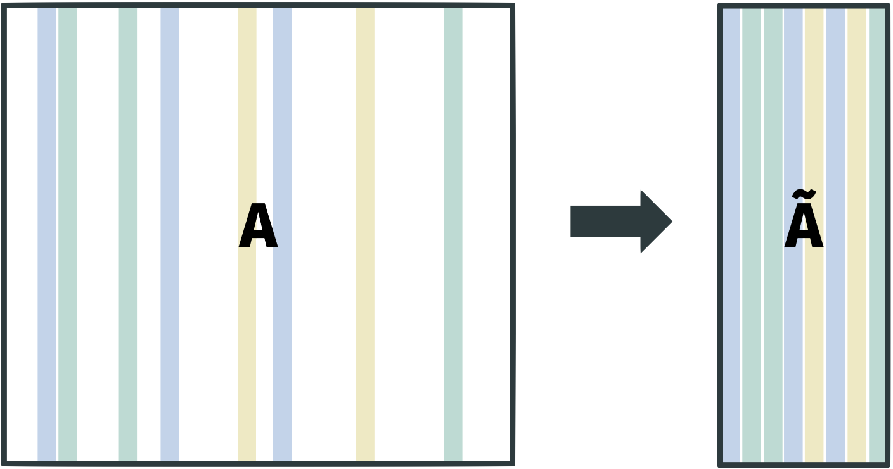
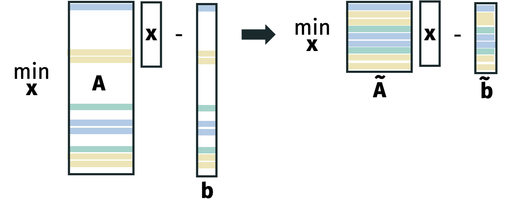
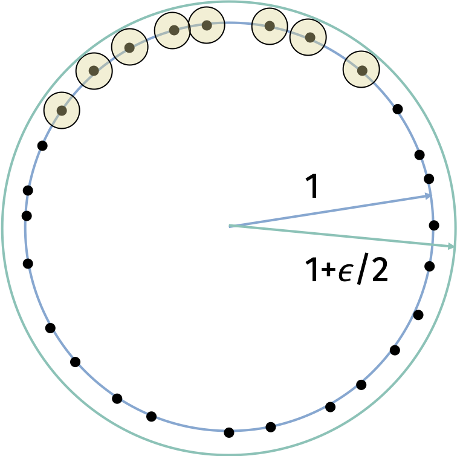

Consider a matrix $\mathbf{M} \in \mathbb{R}^{n \times n}$.
The main idea of randomized numerical linear algebra is to compress a matrix using a randomized method such as subsampling and
then solve the problem we are interested in on the compressed matrix.

For example, we can approximately multiply two matrices by subsampling the rows and columns of the matrices.

We can also approximately solve regression problems by subsampling the rows of the matrix.

Today, we will discuss randomized approximate regression using a Johnson-Lindenstrauss matrix for compression.

The input is a matrix $\mathbf{A} \in \mathbb{R}^{n \times d}$ and a vector $\mathbf{b} \in \mathbb{R}^n$.

Consider the optimal solution to the least squares problem
$$
\mathbf{x}^* = \arg \min_{\mathbf{x} \in \mathbb{R}^d} \| \mathbf{A} \mathbf{x} - \mathbf{b} \|_2^2
$$
and the approximate solution
$$
\tilde{\mathbf{x}} = \arg \min_{\mathbf{x} \in \mathbb{R}^d} \| \mathbf{\Pi} \mathbf{A} \mathbf{x} - \mathbf{\Pi} \mathbf{b} \|_2^2
$$

where $\mathbf{\Pi} \in \mathbb{R}^{m \times n}$ is a Johnson-Lindenstrauss matrix with $m \ll n$ rows.

The goal is to show that the quality of the approximate solution is close to the quality of the optimal solution.

**Randomized Linear Regression:**
Let $\mathbf{\Pi}$ be a properly scaled JL matrix (random Gaussian, random sign, sparse matrix, etc.) with $m = O(d/\epsilon^2)$ rows.
Then, with probability $9/10$, for any $\mathbf{A} \in \mathbb{R}^{n \times d}$ and $\mathbf{b} \in \mathbb{R}^n$,
$$
\| \mathbf{A} \tilde{\mathbf{x}} - \mathbf{b} \|_2^2
\leq 
(1+\epsilon)
\| \mathbf{A} \mathbf{x}^* - \mathbf{b} \|_2^2.
$$

We will prove the theorem using an $\epsilon$-net argument.
The technique is a popular approach for applying our standard concentration inequality and union bound argument to an infinite number of events.
While the result we consider today is interesting,
our real motivation is to explore this kind of argument because
it appears in many other contexts in theoretical computer science and machine learning.

In order to prove the theorem, we will prove the following claim.

**Claim:**
Under the same conditions as the theorem, for all $\mathbf{x} \in \mathbb{R}^d$,
\begin{align*}
(1-\epsilon) \| \mathbf{A} \mathbf{x} - \mathbf{b} \|_2^2
\leq \| \mathbf{\Pi} \mathbf{A} \mathbf{x} - \mathbf{\Pi} \mathbf{b} \|_2^2
\leq (1+\epsilon) \| \mathbf{A} \mathbf{x} - \mathbf{b} \|_2^2.
\end{align*}

With the claim, we can prove the theorem
since
\begin{align*}
\| \mathbf{A} \tilde{\mathbf{x}} - \mathbf{b} \|_2^2
&\leq \frac1{1-\epsilon} \| \mathbf{\Pi} \mathbf{A} \tilde{\mathbf{x}} - \mathbf{\Pi} \mathbf{b} \|_2^2 \\
& \leq \frac1{1-\epsilon}  \| \mathbf{\Pi A} \mathbf{x}^* - \mathbf{\Pi b} \|_2^2 \\
& \leq \frac{1+\epsilon}{1-\epsilon} \| \mathbf{A} \mathbf{x}^* - \mathbf{b} \|_2^2
\end{align*}
where the first and third inequalities are by the claim and the second inequality is by the optimality of $\tilde{\mathbf{x}}$ for the compressed regression problem.

Recall the following lemma that we previously proved.

**Distributional JL Lemma**:
If $\mathbf{\Pi}$ is a properly scaled JL matrix with $m = O(\log(1/\delta) /\epsilon^2)$ rows then for any fixed $\mathbf{y}$,
$$
(1-\epsilon) \| \mathbf{y} \|_2^2
\leq \| \mathbf{\Pi} \mathbf{y} \|_2^2
\leq (1+\epsilon) \| \mathbf{y} \|_2^2
$$
with probability $1-\delta$.

The challenge in going from the distributional JL lemma to the claim is that the JL lemma only holds for a fixed vector $\mathbf{y}$ whereas we need it to hold for an *infinite* number of vectors.

Note that all vectors of the form $\mathbf{Ax - b}$ lie in a low dimensional space spanned by $d+1$ vectors where $d$ is the number of columns in $\mathbf{A}$.
So even though the set is infinite, it is "simple" in some sense.

Our goal is to prove the following theorem.

**Subspace Embedding Theorem:**
Let $\mathcal{U} \subset \mathbb{R}^n$ be a $d$-dimensional subspace.
If $\mathbf{\Pi}$ is chosen from any distribution satisfying the distributional JL Lemma, then with probability $1-\delta$,
$$
(1-\epsilon) \| \mathbf{y} \|_2^2
\leq \| \mathbf{\Pi} \mathbf{y} \|_2^2
\leq (1+\epsilon) \| \mathbf{y} \|_2^2
$$
for all $\mathbf{y} \in \mathcal{U}$ as long as $m = O \left( \frac{d \log(1/\epsilon) + \log(1/\delta)}{\epsilon^2} \right)$.

It is possible to obtain a slightly tighter bound of $O \left( \frac{d + \log(1/\delta)}{\epsilon^2} \right)$ by using a more careful analysis.

With the subspace embedding theorem, the claim follows by applying the theorem to the $d+1$ dimensional subspace spanned by the $d$ columns of $\mathbf{A}$ and $\mathbf{b}$.

The first observation in proving the subspace embedding theorem is that it suffices to prove it for all vectors $\mathbf{w}$ on the unit sphere in $\mathcal{U}$.
This observation follows from linearity:
Any point $\mathbf{v} \in \mathcal{U}$ can be written as $c \mathbf{w}$ for some scalar $c$ and some point $\mathbf{w}$ on the sphere
$S_{\mathcal{U}} = \{ \mathbf{w} \in \mathcal{U} : \| \mathbf{w} \|_2 = 1 \}$.
If 
\begin{align*}
(1-\epsilon) \| \mathbf{w} \|_2
\leq \| \mathbf{\Pi} \mathbf{w} \|_2
\leq (1+\epsilon) \| \mathbf{w} \|_2
\end{align*}
then
\begin{align*}
c(1-\epsilon) \| \mathbf{w} \|_2
\leq c \| \mathbf{\Pi} \mathbf{w} \|_2
\leq c(1+\epsilon) \| \mathbf{w} \|_2
\end{align*}
and therefore
\begin{align*}
(1-\epsilon) \| c \mathbf{w} \|_2
\leq \| \mathbf{\Pi} c \mathbf{w} \|_2
\leq (1+\epsilon) \| c \mathbf{w} \|_2.
\end{align*}

Now that we have restricted our problem to proving the theorem on the unit sphere, our intuition is that there are not too many "different" points on a $d$-dimensional sphere.

We call $\mathcal{N}_\epsilon$ the $\epsilon$-net that includes a representative set of points.
If we can prove that
\begin{align*}
(1-\epsilon) \| \mathbf{w} \|_2
\leq \| \mathbf{\Pi} \mathbf{w} \|_2
\leq (1+\epsilon) \| \mathbf{w} \|_2
\end{align*}
for all points $\mathbf{w} \in \mathcal{N}_\epsilon$, we can hopefully extend the result to all points on the sphere.

**Lemma (Epsilon Net):**
For any $\epsilon \leq 1$, there exists a set $\mathcal{N}_\epsilon \subset S_\mathcal{U}$ with $| \mathcal{N}_\epsilon | \leq \left( \frac{3}{\epsilon} \right)^d$ such that for all $\mathbf{v} \in S_\mathcal{U}$,
$$
\min_{\mathbf{w} \in \mathcal{N}_\epsilon} \| \mathbf{v} - \mathbf{w} \|_2 \leq \epsilon.
$$

::: {.proof-block}

Proof

We will construct the $\epsilon$-net by a greedy algorithm.
Initially, the $\epsilon$-net $\mathcal{N}_\epsilon$ is empty.
While there is a point $\mathbf{v}$ on the sphere that is not within $\epsilon$ of any point in $\mathcal{N}_\epsilon$, we will add $\mathbf{v}$ to $\mathcal{N}_\epsilon$.
After running the algorithm, we will have a set $\mathcal{N}_\epsilon$ such that
$$
\min_{\mathbf{w} \in \mathcal{N}_\epsilon} \| \mathbf{v} - \mathbf{w} \|_2 \leq \epsilon.
$$
(Otherwise, the procedure would not have terminated.)
It remains to show that the $\epsilon$-net is not too large.

We can count the number of points in the $\epsilon$-net by considering the volume of the sphere.
Each point in the net is at least $\epsilon$ away from every other point in the net (otherwise, the point would not have been added).
So we can imagine a ball of radius $\frac{\epsilon}{2}$ around each point in the net that does not overlap with any other ball.
All of these balls live in a larger ball of radius $1+\frac{\epsilon}{2}$.
Let's count the number of non-overlapping balls of radius $\frac{\epsilon}{2}$ that fit in the larger ball of radius $1+\frac{\epsilon}{2}$.
We know that the volume of a ball with radius $r$ in $d$ dimensions is
$$
\text{vol}(d,r) = c \cdot r^d
$$
where $c$ is a constant that depends on the dimension but not on the radius.

Because all the small balls are non-overlapping and live in the larger ball, we know
\begin{align*}
\text{vol}\left(d,\frac{\epsilon}{2} \right) | \mathcal{N}_\epsilon |
&\leq \text{vol}(d,1+\frac{\epsilon}{2}) \\
| \mathcal{N}_\epsilon | &\leq \frac{\text{vol}(d,1+\frac{\epsilon}{2})}{\text{vol}(d,\frac{\epsilon}{2})} \\
&\leq \frac{(1+\frac{\epsilon}{2})^d}{(\frac{\epsilon}{2})^d} \leq \left( \frac{3}{\epsilon} \right)^d
\end{align*}

:::

With this claim in hand,
we will first consider how to preserve the norms of all points in the net $\mathcal{N}_\epsilon$.
To ensure the bound holds for all points in the net, we require a failure probability of at most $\delta / |\mathcal{N}_\epsilon|$ per point. Since $| \mathcal{N}_\epsilon | \leq \left( \frac{3}{\epsilon} \right)^d$, we can set $\delta' = \left(\frac{\epsilon}{3} \right)^d \delta$.
As long as $\mathbf{\Pi}$ has 

$$O \left( \frac{\log(1/\delta')}{\epsilon^2} \right) = 
O \left( \frac{d \log(1/\epsilon) + \log(1/\delta)}{\epsilon^2} \right)$$ rows,
then by a union bound,
$$
(1-\epsilon) \| \mathbf{w} \|_2^2
\leq \| \mathbf{\Pi} \mathbf{w} \|_2^2
\leq (1+\epsilon) \| \mathbf{w} \|_2^2
$$
for all $\mathbf{w} \in \mathcal{N}_\epsilon$ with probability $1-\delta$. 
Taking the square root and adjusting $\epsilon$ by a constant factor, we can assume this implies a bound on the standard norm:
$$
(1-\epsilon) \| \mathbf{w} \|_2
\leq \| \mathbf{\Pi} \mathbf{w} \|_2
\leq (1+\epsilon) \| \mathbf{w} \|_2
$$

Next, we will extend the result to all points on the sphere.
For some set of points in the net $\mathbf{w}_0, \mathbf{w}_1, \mathbf{w}_2, \ldots \in \mathcal{N}_\epsilon$, any point on the sphere $\mathbf{v} \in S_\mathcal{U}$ can be written as
$$
\mathbf{v} = \mathbf{w}_0 + c_1 \mathbf{w}_1 + c_2 \mathbf{w}_2 + \ldots
$$
for constants $c_1, c_2, \ldots$ where $|c_\ell| \leq \epsilon^\ell$.

We can prove this through a greedy construction and the $\epsilon$-net property.
\begin{align*}
\mathbf{w}_0 &= \arg \min_{\mathbf{w} \in \mathcal{N}_\epsilon} \| \mathbf{v} - \mathbf{w} \|_2
\qquad \mathbf{r}_1 = \mathbf{v} - \mathbf{w}_0 \qquad c_1 = \| \mathbf{r}_1 \|_2 \\
\mathbf{w}_1 &= \arg \min_{\mathbf{w} \in \mathcal{N}_\epsilon} \| \frac{\mathbf{r}_1}{c_1} - \mathbf{w} \|_2
\qquad \mathbf{r}_2 = \mathbf{v} - \mathbf{w}_0 - c_1 \mathbf{w}_1 
\qquad c_2 = \| \mathbf{r}_2 \|_2  \\
\mathbf{w}_2 &= \arg \min_{\mathbf{w} \in \mathcal{N}_\epsilon} \| \frac{\mathbf{r}_2}{c_2} - \mathbf{w} \|_2
\qquad \mathbf{r}_3 = \mathbf{v} - \mathbf{w}_0 - c_1 \mathbf{w}_1 - c_2 \mathbf{w}_2
\qquad c_3 = \| \mathbf{r}_3 \|_2 \\
&\vdots
\end{align*}
We will inductively prove that $\| \mathbf{r}_\ell \|_2 \leq \epsilon^\ell$.
To see this, observe that
\begin{align*}
\left\| \frac{\mathbf{r}_{\ell}}{c_{\ell}} - \mathbf{w}_\ell \right\|_2
\leq \epsilon
\end{align*}
by the property of the $\epsilon$-net.
Multiplying by $|c_\ell|$ gives
\begin{align*}
\| \mathbf{r}_{\ell+1} \|_2 =
\| \mathbf{r}_{\ell} - c_\ell \mathbf{w}_\ell \|_2
\leq \epsilon c_\ell = \epsilon \| \mathbf{r}_{\ell} \|_2
\end{align*}
The inductive claim follows.

Applying triangle inequality, we have that
\begin{align*}
\| \mathbf{\Pi v} \|_2 &=
\| \mathbf{\Pi w}_0 + c_1 \mathbf{\Pi w}_1 + c_2 \mathbf{\Pi w}_2 + \ldots \|_2 \\
&\leq \| \mathbf{\Pi w}_0 \|_2 + c_1 \| \mathbf{\Pi w}_1 \|_2 + c_2 \| \mathbf{\Pi w}_2 \|_2 + \ldots \\
&\leq \| \mathbf{\Pi w}_0 \|_2 + \epsilon \| \mathbf{\Pi w}_1 \|_2 + \epsilon^2 \| \mathbf{\Pi w}_2 \|_2 + \ldots \\
&\leq (1+\epsilon) \| \mathbf{w}_0 \|_2 + \epsilon (1+\epsilon) \| \mathbf{w}_1 \|_2 + \epsilon^2 (1+\epsilon) \| \mathbf{w}_2 \|_2 + \ldots \\
&= 1 + 2 \epsilon + 2 \epsilon^2 + 2 \epsilon^3 \ldots \\
&\leq \frac{1}{1-2\epsilon} \leq 1 + 4\epsilon.
\end{align*}

For the other direction, we will use that
$\| \mathbf{a} + \mathbf{b} \|_2 \geq \| \mathbf{a} \|_2 - \| \mathbf{b} \|_2$.
To see this, observe that
$\| \mathbf{a} \|_2 \leq \| \mathbf{a} + \mathbf{b} \|_2 + \| \mathbf{b} \|_2$ by the triangle inequality applied to the vectors $\mathbf{a} + \mathbf{b}$ and $-\mathbf{b}$.
By repeatedly applying this inequality, we have that
\begin{align*}
\| \mathbf{\Pi v} \|_2 &=
\| \mathbf{\Pi w}_0 + c_1 \mathbf{\Pi w}_1 + c_2 \mathbf{\Pi w}_2 + \ldots \|_2 \\
&\geq \| \mathbf{\Pi w}_0 \|_2 - c_1 \| \mathbf{\Pi w}_1 \|_2 - c_2 \| \mathbf{\Pi w}_2 \|_2 - \ldots \\
&\geq \| \mathbf{\Pi w}_0 \|_2 - \epsilon \| \mathbf{\Pi w}_1 \|_2 - \epsilon^2 \| \mathbf{\Pi w}_2 \|_2 - \ldots \\
&\geq (1-\epsilon) \| \mathbf{w}_0 \|_2 - \epsilon (1+\epsilon) \| \mathbf{w}_1 \|_2 - \epsilon^2 (1+\epsilon) \| \mathbf{w}_2 \|_2 - \ldots \\
&= (1-\epsilon) - (1+\epsilon)(\epsilon + \epsilon^2 + \epsilon^3 + \ldots) \\
&= (1-\epsilon) - (1+\epsilon)\frac{\epsilon}{1-\epsilon} \\
&= \frac{1 - 3\epsilon}{1-\epsilon} \\
&\geq 1 - 4\epsilon.
\end{align*}

So we have proven that
\begin{align*}
(1-O(\epsilon)) \| \mathbf{v} \|_2
\leq \| \mathbf{\Pi v} \|_2
\leq (1+O(\epsilon)) \| \mathbf{v} \|_2
\end{align*}
for all vectors $\mathbf{v}$ on the sphere.
Adjusting $\epsilon$ gives the subspace embedding theorem.
