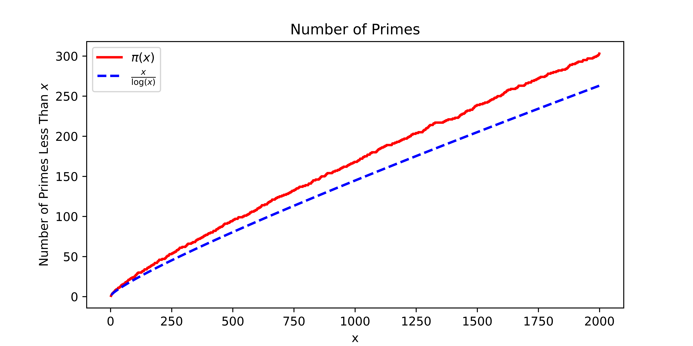
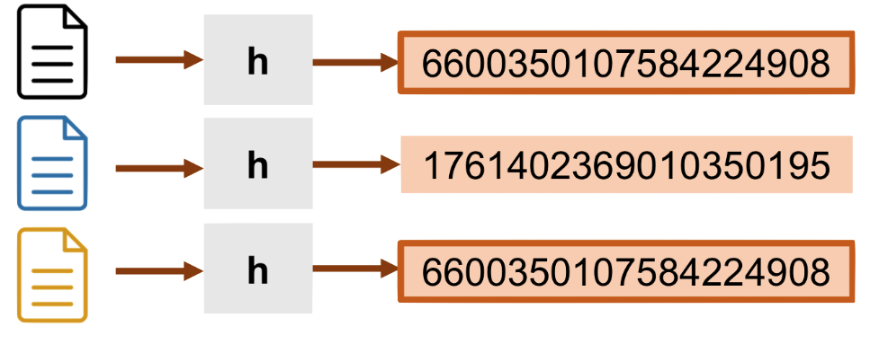

In this class, we'll discuss a randomized algorithm called *fingerprinting*. But first, we'll revisit universal hash functions and explore prime numbers.

**Universal Hash Functions:**
Consider a random hash function $h: \mathcal{U} \rightarrow \{1, \ldots, m\}$.
We say $h$ is universal if, for any fixed $x,y \in \mathcal{U}$,
$$
\Pr(h(x) = h(y)) \leq \frac{1}{m}.
$$

Recall that we can efficiently construct a universal hash function with the following approach.
Let $p$ be a prime number between $|\mathcal{U}|$
and $2|\mathcal{U}|$.
Let $a$ and $b$ be random numbers in $0, \ldots, p$ and make sure $a \neq 0$.
Then the hash function
$$
h(x) = [(ax + b) \mod p] \mod m
$$
is universal.

We won't prove that $h$ is universal but we will get a flavor for what tools are used in the proof.

Notice that once we have a prime number, we only have to store $a$, $b$, $p$, and $m$.
Then computing the hash function only requires a few arithmetic operations.
This hash function seems easy to implement *except* for the challenge of finding a large prime number to use.

### Finding Prime Numbers

Finding a prime number seems pretty tough so let's consider the simpler problem of checking whether a number is prime.
Given a number $x$, how can we efficiently check that $x$ is prime?
Recall a number is prime if it is larger than 1 and can only be divided evenly by $1$ and itself.
The first few primes are $2,3,5,7,11,13,17,19,\ldots$.
Is 2023 prime?
What about 2342098230982509?
How can we check in general?

Suppose we have an integer represented as a length $n$ binary string.
For example,
$$
x = 011100100110011111\ldots0101011.
$$
The naive prime checking algorithm of simply dividing $x$ by all integers less than $x$ runs in $O(2^{n})$.
The NYU Greene supercomputing cluster has 2 petaflops of throughput. 
When $n=128$, we would need 1 million Greene clusters running for 1 million years to check if $x$ is prime.

Fortunately, there is a much faster algorithm.
In papers published in 1976 and 1980, Miller and Rabin presented a randomized algorithm that runs in time $O(n^3 \log(1/\delta))$.
With probability $1-\delta$, the algorithm determines if an $n$-bit integer is prime.
If $n = 128$ and $\delta = 10^{-9}$,
then $n^3 \log(1/\delta) \approx 60$ million operations.
We can run this in less than a tenth of a second on a modern computer!
In addition to the practical applications,
the Miller-Rabin algorithm was a big breakthrough that popularized randomized algorithms.

<!--
For decades, it was not clear how to get an algorithm that runs in polynomial time *deterministically*.
In 2004, Agrawal, Kayal, and Saxena published a deterministic algorithm that runs in polynomial time.
The algorithm itself is much slower than the randomized algorithms but it was a big breakthrough.
-->

Why was it such a big deal to get an efficient algorithm for checking if a number is prime?
Well, one big reason is that prime numbers form the basis for modern public key cryptography.
In cryptography, we imagine there are two parties, Alice and Bob, that communicate with each other. Bob wants to send Alice a message so that only Alice can read it.
If someone else intercepts it, the message should be unreadable.

The obvious way for Alice and Bob to communicate securely is to share a secret key in advance.
This is the approach that persisted for centuries.
However, physically meeting to share a secret key is impractical if there are many senders and receivers.

A more clever way for Alice and Bob to communicate securely is to use a *lock box*.
The lock box has the property that anyone can deliver mail but only Alice can read the mail.

The way we implement the lock box in practice is with RSA encryption.
The idea is to have a private key and a public key.
The private key consists of two very large prime numbers $p$ and $q$.
The public key is the product $pq$.
Even though checking if a number is prime can be done quickly, we still do not have efficient algorithms for factoring numbers.
(In fact, one of the reasons that quantum computers are so exciting is that they can factor numbers efficiently. But, alas, we don't know how to build a quantum computer large enough to factor any interesting number.)

The challenge of RSA encryption is to find two large primes.
This is the same problem we faced when we wanted to construct a hash function!

Here's a naive algorithm for finding primes:
Pick a random large number $x$ and check if it is prime.
If it's not prime, we repeat.
Surprisingly, this algorithm works!
The reason it works is because there are lots of primes even among large numbers.
The prime number theorem formalizes this statement.

**Prime Number Theorem:**
Let $\pi(x)$ denote the number of primes less than some integer $x$.
For $x > 55$,
$$
\frac{x}{\log x} \leq \pi(x)
\leq \frac{x}{\log x - 4}.
$$

This is somewhat surprising because as numbers get larger, there are more smaller numbers that could be their factors.

Let's plot the number of primes and the bound in the prime number theorem. (Note the upper bound only makes sense for $x \geq 55$.)

The prime number theorem tells us that if
we select a random 128 bit number $x$,
the chance that it is prime is greater than
$$
\frac{1}{\log(2^{128})} \geq 1/90.
$$

After a few hundred tries, we will almost definitely find a prime number.
In general, we need $O(n)$ tries to find an $n$-bit prime number.

In the remainder of the class, we'll discuss a simple but important application of prime numbers to hashing.

### Algorithm

Our goal is to construct a compact "fingerprint" $h(f)$ for any given file $f$ with two properties:

1. The fingerprints $h(f_1)$ and $h(f_2)$ should be different with high probability if the contents of $f_1$ and $f_2$ differ *at all.*

2. If the contents of $f_1$ and $f_2$ are identical, we should have $h(f_1) = h(f_2)$.

Fingerprinting is useful for quickly checking if two versions of the same file are identical.
This is quite helpful for version control on systems like Git.
The advantage is that we do not need to communicate the entire file between the server and local computer to perform the check; we only need to communicate the small fingerprint.

Another application is to check if two images are identical. This is useful in contexts where we want to remove duplicate pictures.
However, if the images are changed at all (e.g. compressed or converted to a different format), the fingerprints will be different.
In a later class, we'll see a method which is robust to these changes.

The approach we'll learn about today is called a Rabin fingerprint.
Let the file $f=010\ldots100$ be represented as $n$ bits.
We'll interpret $f$ as a number between 0 and $2^n$.

We'll construct the fingerprint function $h$ as follows.
We choose a random prime number $p$ between $2$
and $t n \log(tn)$ for some constant $t$.
Then
$$
h(f) = f \mod p.
$$
Notice that we can store $h(f)$ in $\log p$.
This is at most 
$$
\log (tn \log tn) \leq \log((tn)^2)
$$
$$
= O(\log( tn)) = O(\log n + \log t)
$$ bits.

Let's analyze this fingerprint function.

**Claim:** If $f_1 \neq f_2$, then $h(f_1) = h(f_2)$ with probability at most $\frac{2}{t}$.

Since our fingerprint only takes $O(\log n + \log t)$ space, we can set $t$ to be *super large*.
Then, effectively, the probability of $h(f_1)$ and $h(f_2)$ colliding is negligible for all practical purposes.

Observe that if $h(f_1) = h(f_2)$, then
$$
f_1 - f_2 \mod p = 0.
$$
In other words, we only fail if $d = f_1 - f_2$ is divisible by $p$.

We'll analyze the chance that $d$, which is an integer less than $2^n$, is divisible by a random prime $p \in \{2, \ldots, tn \log(tn)\}$.

The first step is to upper bound the number of distinct prime factors of $d$.
Since each prime factor is at least $2$ and $d$ is at most $2^n$, there can be at most $n$ distinct prime factors of $d$.

The second step is to lower bound the number of primes less than $tn \log(tn)$. 
By the prime number theorem,
there are at least $\frac{tn \log(tn)}{\log(tn \log(tn))}$ primes in this range.
So the chance that a random prime $p$ is a factor of $d$ is at most
$$
\frac{n}{\frac{tn \log(tn)}{\log(tn \log(tn))}}
= \frac{\log(tn \log(tn))}{t \log(tn)}
\leq \frac{2 \log(tn)}{t \log(tn)} = \frac{2}{t}.
$$
So, for two files $f_1 \neq f_2$, the chance that
$h(f_1) = h(f_2)$ is at most $\frac{2}{t}$.

Let's see how much space we need for the fingerprint in practice.
Set $t$ to be $10^{18}$.
(For context, $10^{-18}$ is the chance you win the Powerball lottery twice in a row.)
Then the fingerprint size is at most $2 \log_2(nt) = 2 \log_2(n) + 2 \log_2(10^{18})$ bits.
Suppose we are fingerprinting 1 megabyte image files so $n \approx 8 \times 10^6$.
Then the fingerprint size is $166$ bits.
This amounts to a 50,000-fold reduction in space compared to sending the original file!
